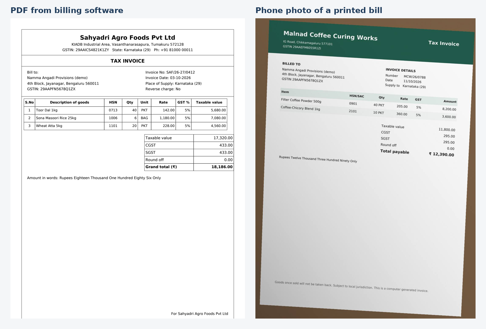
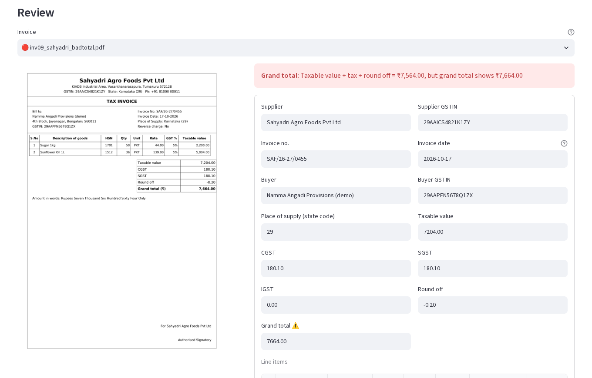
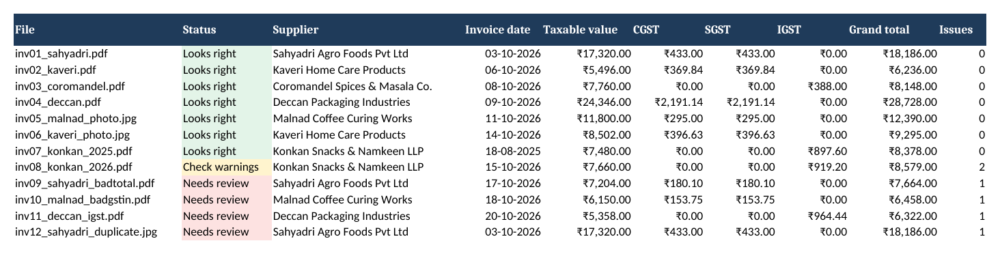

# Invoice to Excel

[](https://github.com/VydyaP/invoice-to-excel/actions/workflows/tests.yml)

**Purchase bills in (PDFs and phone photos). A checked Excel sheet out. A person reviews only what's flagged.**

Small shops and distributors get dozens of supplier bills a month and someone types each one into Excel or Tally: supplier, GSTIN, invoice number, date, every line, every tax amount. It's slow, and typos in GSTINs or totals cause problems at GST filing time.

This tool lets AI read each bill, then checks the result with plain arithmetic and GST rules, **not** more AI. Anything that doesn't add up is flagged with a plain reason, shown next to the original bill, and fixed in a couple of clicks. Everything else goes straight to Excel.

| Input: PDFs and phone photos | Review: the bill beside what was read, with the reason it's flagged |
|---|---|
|  |  |



> Every invoice, business name and GSTIN in this repository is **fictional**, generated by `scripts/make_samples.py` for a made-up store ("Namma Angadi Provisions"). No real business data is used.

---

## How it works

```
 PDF / photo ──► AI reads it ──► clean-up ──► checks (no AI) ──► review screen ──► Excel / CSV
               (Claude, forced    (₹, commas,   arithmetic, GSTIN    person fixes
                into a fixed      day-first     checksum, GST rate   only flagged
                JSON format)      dates)        rules, duplicates    invoices
```

1. **Read.** Each file goes to Claude (`claude-haiku-5-5` by default) with a fixed JSON schema, so the answer always has the same fields. The instructions say: copy what's printed, never correct or recalculate, use null rather than guess. Photos are rotated upright and resized first.
2. **Clean up.** `₹1,23,456.50`, `Rs. 90`, `18%`, `03/10/2026` and similar become proper numbers and dates.
3. **Check.** Rules that don't depend on AI, so they catch both AI misreads and real mistakes on the bill:

| Check | What it catches |
|---|---|
| GSTIN checksum | The 15th character of every GSTIN is a check digit. One misread or mistyped character is caught. |
| Totals add up | Lines add up to the taxable value; taxable value + tax + round off = grand total (₹1 tolerance for rounding) |
| Line maths | Quantity × rate = line amount |
| Tax amount | Tax charged matches the line rates |
| CGST + SGST vs IGST | Same state must charge CGST + SGST (equal halves); different states must charge IGST |
| GST rate valid for the date | From 22 Sep 2025 the 12% and 28% slabs were removed. A 12% line on a 2026 bill is flagged; on a 2025 bill it's fine. |
| Duplicates | Same supplier GSTIN and invoice number twice in a batch, even if one is a photo and the number is written differently |
| Missing / impossible values | No invoice number, a date like 31-02-2026, a date in the future |

4. **Review.** Invoices needing review are listed first. The page shows the bill beside every field; flagged fields are marked with the reason. Edit and press **Save changes and re-check**.
5. **Export.** An Excel workbook (Invoices, Line items, Checks, About) with ₹ lakh formatting and real dates, or CSV files that open correctly in Excel.

## Accuracy

**Not measured yet.** The evaluation script (`scripts/evaluate.py`) scores every field the AI reads against hand-typed answer keys for all 12 samples and checks that the 5 planted problems are caught without false alarms. It needs an API key, so its results will be published in [docs/accuracy.md](docs/accuracy.md) once it has been run. Until then this README makes no accuracy claim.

What *is* tested: the checks find exactly the 5 planted problems in the answer keys and nothing else (see `tests/test_checks.py`).

## Try it

```bash
python3 -m venv .venv && source .venv/bin/activate
pip install -r requirements.txt
streamlit run app.py
```

- **Try the sample invoices** works without an API key. Until the AI's answers have been recorded, it uses the hand-typed correct values and says so on screen; after `scripts/evaluate.py --record` it replays what the AI actually returned.
- **Read your own invoices** needs an Anthropic API key in the environment or `.streamlit/secrets.toml`. See [docs/setup.md](docs/setup.md). The key is never typed into the page.

## Cost

Each invoice is one API call. A one-page PDF is roughly 2,000–3,000 input tokens plus the instructions, and the answer is a few hundred tokens. At the per-token prices in `src/invoice_to_excel/pipeline.py` that is well under ₹1 per invoice. The app shows an estimate for every batch, and `docs/accuracy.md` will show the measured cost. Check [Anthropic's pricing page](https://docs.claude.com/en/docs/about-claude/pricing) for current rates.

## Project layout

```
app.py                          Streamlit review page
src/invoice_to_excel/
  extract.py                    Claude call (PDF/image blocks, JSON schema, fallbacks, plain error messages)
  schema.py                     Fields, JSON schema, clean-up of the AI's answer
  gst.py                        GSTIN checksum, state codes, GST rates by date
  checks.py                     All checks (no AI)
  pipeline.py                   Files in -> checked results out; cost estimate
  export.py                     Excel and CSV
  preview.py                    Page images for the review screen
scripts/
  make_samples.py               Builds the 12 fictional invoices and their answer keys
  evaluate.py                   Measures accuracy; --record saves answers for the free demo
  make_doc_images.py            README images
samples/invoices, samples/answers
demo/recorded/                  AI answers replayed by the demo (added by evaluate.py --record)
tests/                          90 tests; the AI is replaced by a fake, so no key is needed
```

## Tests

```bash
pip install -r requirements-dev.txt
pytest
```

The Claude client is replaced with a fake in tests, covering the request format, the structured-output fallback, rate-limit / auth / outage messages, and truncated or refused answers. The web page is tested with Streamlit's `AppTest`.

## Limitations

- **Accuracy is unmeasured** until the evaluation is run, and the samples are clean, computer-made invoices. Handwritten bills, faded thermal receipts and multi-page invoices with many lines will be harder.
- The checks catch numbers that **don't add up**. If the AI misreads a value in a way that still adds up (for example both a line amount and the total), the checks can't see it. That's why the original bill sits beside the fields.
- Built for Indian **B2B GST tax invoices**. It doesn't handle e-invoice QR codes, TDS/TCS, reverse charge accounting, cess, or foreign currency.
- The GST rate list covers the main slabs and common special rates. Unusual rates are flagged as warnings, not errors.
- Duplicate detection is within one batch, not against previously exported months.
- It exports Excel/CSV, not a direct Tally or Zoho import.
- Invoices are sent to Anthropic's API to be read. Before using it on a client's bills, read Anthropic's data-use terms and tell the client.

## Possible next steps for a client

- Tally-ready import file, or push to Zoho Books / Google Sheets
- Check against previous months' exports for duplicates
- Match against GSTR-2B to find bills the supplier hasn't filed
- Watch an email inbox or WhatsApp number for new bills

## Licence

MIT. See [LICENSE](LICENSE).
